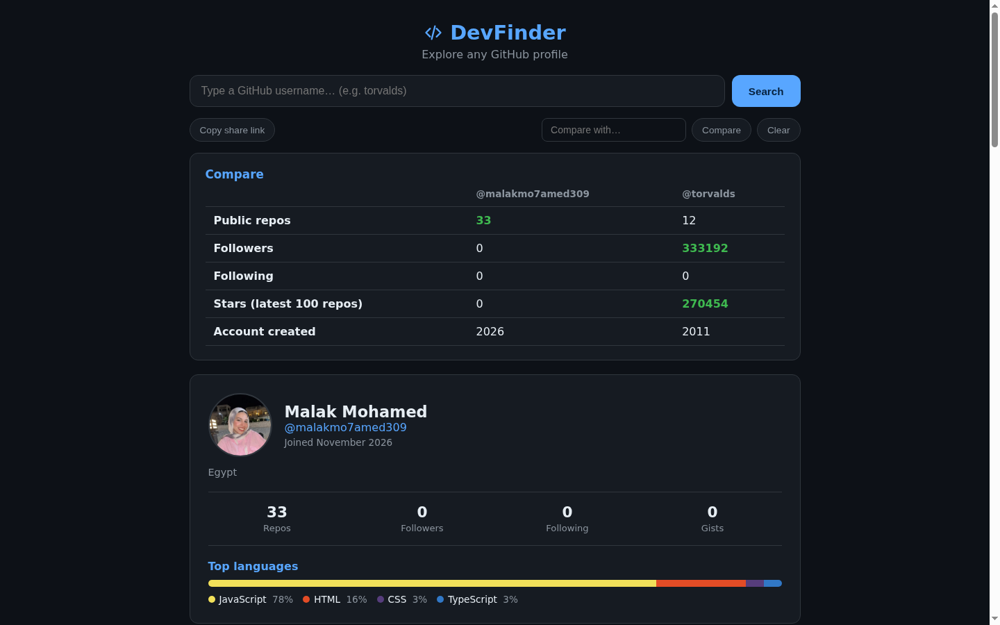
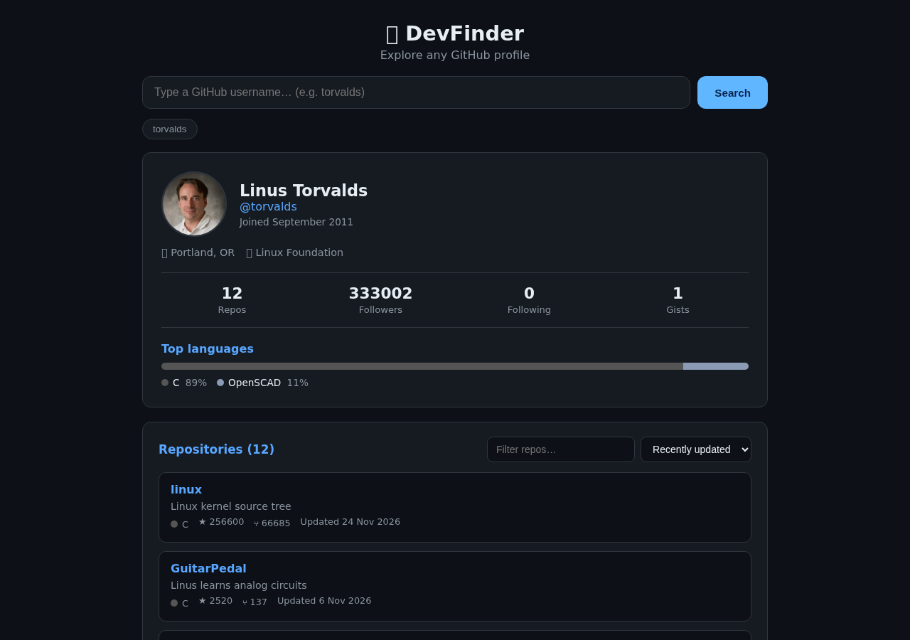
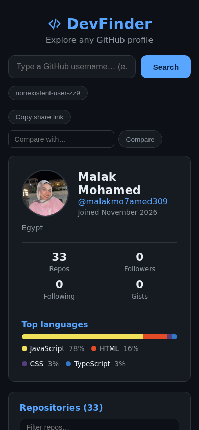

# DevFinder - GitHub Profile Explorer

A GitHub profile explorer built with React. Type any GitHub username and get
their profile, stats, top languages and a filterable, sortable repository
list. Powered by the public [GitHub REST API](https://docs.github.com/rest),
no API key needed.

**Live demo:** https://malakmo7amed309.github.io/github-explorer/

## Features

- Compare two profiles side by side (repos, followers, stars, join year) with the leader highlighted
- Shareable links: the URL keeps the user and the compared user (`?u=...&vs=...`) plus a copy-link button
- Filter repos by language, copy a repo's clone URL

- Look up any public GitHub user by username
- Profile card: avatar, name, bio, location, company, website and join date
- Stats: public repos, followers, following and gists
- Top languages bar computed from the user's own (non-fork) repos, with the
  official GitHub language colors
- Repository list with live text filter and sorting (recently updated, most
  stars, most forks, name A-Z)
- Search history saved as quick chips in `localStorage`
- Friendly error states: unknown user, rate limit, offline
- GitHub-dark theme, fully responsive

## Tech stack

- React 19 + Vite
- Axios for API requests
- GitHub REST API (`/users/{name}` and `/users/{name}/repos`)
- `localStorage` for search history
- Plain modern CSS (custom properties, grid, flexbox)

## Screenshots

| Profile + repos | Another user |
| --- | --- |
|  |  |

| Mobile |
| --- |
|  |

## Run locally

```bash
npm install
npm run dev
```

Then open http://localhost:5173/github-explorer/.

To create a production build:

```bash
npm run build
npm run preview
```

Note: the app calls the GitHub API without a token, which allows 60 requests
per hour per device. The app shows a friendly message if that limit is hit.

## How the code works

New to this codebase? Read [docs/how-it-works.md](docs/how-it-works.md) for a
plain-language walkthrough of the data flow and the main React concepts used
here.
